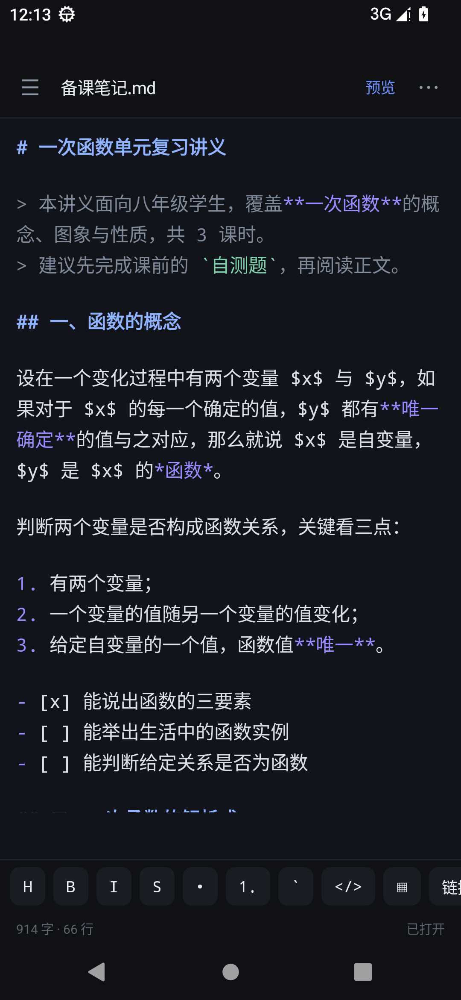
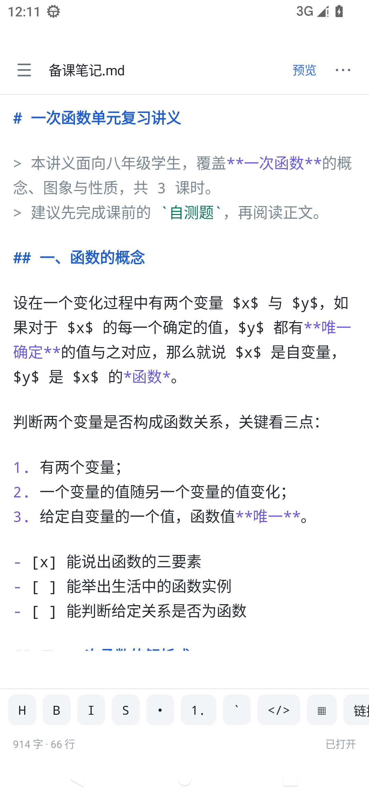
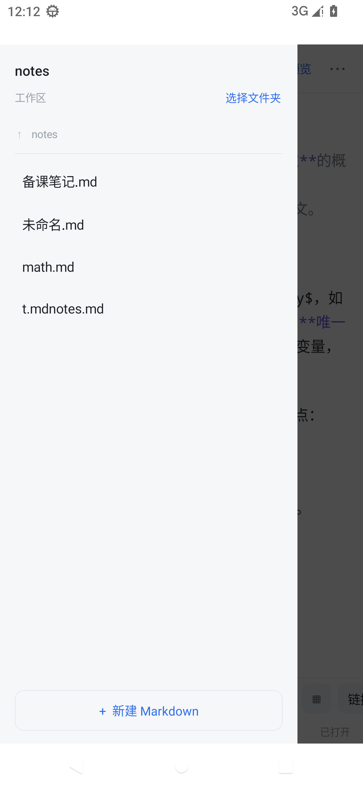

# 墨读 MoDu

一个 65 KB 的 Android Markdown 编辑器。纯 Java + 原生 WebView，**零第三方依赖**，不联网、不要存储权限。

> 目标是手机上「能安心写字」的 Markdown 工具：打开文件夹当工作区，左边选文件，右边边写边看。

**本项目由 [DeepSeek-V4.1-Flash 1017](#制作说明) 制作。**

## 版本

| 版本 | 类型 | 体积 | 说明 |
|:---|:---|:---:|:---|
| **[v2.0.1](../../releases/tag/v2.0.1)** | 编辑器版（当前） | 65 KB | 打开即预览、抽屉左滑关闭。**推荐安装这个** |
| [v2.0.0](../../releases/tag/v2.0.0) | 编辑器版 | 65 KB | 首个编辑器版本：工作区、语法着色、自动保存、查找替换、导出 |
| [v1.0.0](../../releases/tag/v1.0.0) | 纯阅读器 | 53 KB | 最初的阅读版，只读排版，无编辑能力；适合只要看文档的人 |

三个版本包名与签名一致，可逐级覆盖安装。完整改动见 [CHANGELOG](CHANGELOG.md)。

## 截图

| 编辑（深色） | 编辑（浅色） | 预览 | 文件工作区 |
|:---:|:---:|:---:|:---:|
|  |  |  |  |

## 功能

**编辑**

- 打开即预览（排版效果），右上角 `编辑` 切到源码，改完点 `预览` 回到排版
- Markdown 语法着色：标题、引用、列表、加粗/斜体/删除线、行内代码、代码块、链接
- 底部格式工具条：标题、加粗、斜体、删除线、列表、有序列表、行内代码、代码块、表格、链接、待办、引用
- 中文输入法友好：组合输入（拼音未上屏）期间不改动着色，不会丢光标
- 自动保存：停止输入 1.5 秒写回原文件，退出页面时再保存一次
- 查找替换：逐个替换 + 全部替换
- 字数 / 行数统计，字号七档（13–22sp）

**文件**

- 文件夹工作区：走系统文件选择器授权一个目录（SAF），左侧抽屉列出 `.md` / `.markdown` / `.txt`
- 抽屉可左滑关闭（跟手拖动，拖过三成或快速轻扫即收起），也可点遮罩或按返回键收起
- 支持子目录进入 / 返回上级
- 新建、重命名、删除
- 也可以用「其他应用打开」把单个 `.md` 丢进来编辑
- 记住上次打开的文件，下次启动直接恢复

**显示**

- 深色 / 浅色主题（整套 UI，不只正文）
- 预览支持：标题、列表（含嵌套与任务列表）、表格、引用、代码块、分割线、链接
- 公式：`$...$` 与 `$$...$$`，支持 `\frac`、`\sqrt`、上下标、希腊字母和常用数学符号

**导出**

- 导出 PDF（走系统打印服务）
- 导出 HTML（完整单文件，含内联样式）
- 另存为副本
- 只读文件（例如从聊天软件直接「打开」的）会自动识别，提示另存为

## 安装

到 [Releases](../../releases) 下载 `Modu-x.y.z.apk` 安装即可。

- 支持 Android 5.0（API 21）及以上，targetSdk 34
- 首次安装需允许「安装未知来源应用」
- 应用不申请联网权限，也不读写除你授权目录以外的任何文件

## 构建

### 方式一：Android Studio（Gradle）

用 Android Studio（Koala 及以上）直接打开本目录即可，或命令行：

```bash
./gradlew assembleDebug
```

> 版本：AGP 8.5.2 / Gradle 8.7 / JDK 17 / compileSdk 34。

### 方式二：不装 Gradle，直接用 SDK 工具链

只需要 **JDK 17** + **Android SDK（build-tools 34.0.0、platforms/android-34）**：

```bash
export ANDROID_SDK_ROOT=/path/to/android-sdk
export JAVA_HOME=/path/to/jdk-17
./scripts/build-apk.sh
```

产物在 `dist/Modu-<version>.apk`。脚本内部依次调用 aapt2 → javac → d8 → zipalign → apksigner，适合 CI 或没装 Android Studio 的机器。

正式发布请提供自己的签名库：

```bash
export MODU_KEYSTORE=/path/to/release.keystore
export MODU_KEYSTORE_PASS=******
export MODU_KEY_ALIAS=modu
export MODU_KEY_PASS=******   # 不设则与 storepass 相同
```

不提供时会自动生成一个本地调试签名（`build/debug.keystore`，已被 .gitignore 忽略），**不要用于发布**。

### 持续集成（可选）

`docs/github-actions-example.yml` 是一份现成的 GitHub Actions 配置（推送即构建 debug APK 并上传为 artifact）。

要用的话：把它移动到 `.github/workflows/android.yml` 再推送。注意 GitHub 要求推送包含 workflow 文件的 token 具备 `workflow` 权限，否则会被拒绝。

## 项目结构

```
app/src/main/java/com/wbx/mdreader/
  MainActivity.java      界面与交互：抽屉、编辑区、预览、查找替换、导出
  MarkdownRenderer.java  自写 Markdown → HTML 渲染器（含简易 LaTeX 子集）
  SyntaxHighlighter.java 编辑区语法着色（Spannable）
  Workspace.java         SAF 文件夹工作区：列举 / 读写 / 新建 / 重命名 / 删除
  Palette.java           深/浅两套配色
scripts/build-apk.sh     不依赖 Gradle 的打包脚本
```

## 一些实现上的取舍

- **为什么是源码模式而不是所见即所得**：Android 的 `contenteditable` 在中文输入法下容易丢光标、错位；源码 + 预览在手机上更稳，也更省电。
- **为什么不用 AndroidX**：整个应用只有 5 个类，没有 RecyclerView / ViewModel 的需求，用原生控件即可，APK 只有 65 KB，冷启动快。
- **为什么不需要存储权限**：全部文件访问走 SAF（`ACTION_OPEN_DOCUMENT` / `ACTION_OPEN_DOCUMENT_TREE`），权限由系统授予到具体 URI，应用拿不到目录外的任何文件。
- **公式只做了 LaTeX 子集**：完整排版要引入 KaTeX（约 1 MB + 字体），对 65 KB 的应用不划算；`\frac`、`\sqrt`、上下标、常用符号已覆盖中学数学场景。

## 已知限制

- 代码块长行自动换行，换行后不保留缩进
- 预览不加载本地相对路径的图片；网络图片（http/https）可显示
- 没有撤销 / 重做（依赖输入法自身的撤销）
- 没有多标签页，用工作区文件列表代替
- 大文档（> 160 KB）会关闭实时语法着色，避免卡顿

## 制作说明

本项目由 **DeepSeek-V4.1-Flash 1017** 制作：从需求梳理、交互方案、代码实现到真机（Android 13 模拟器）逐项验收，都由它完成。

仓库里的三个版本也是同一来源：v1.0.0 阅读器 → v2.0.0 编辑器 → v2.0.1 体验打磨，改动记录见 [CHANGELOG](CHANGELOG.md)。

## 许可

MIT License，见 [LICENSE](LICENSE)。
